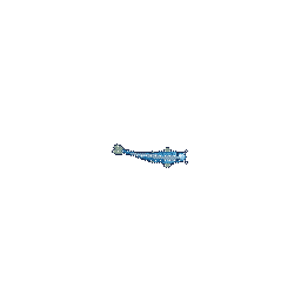

---

## About

I'm a Computer Science student at HCMUT, focused on programming fundamentals, data structures, and building practical software.

C++ is my main language so far. I'm also exploring JavaScript, TypeScript, and backend development. I prefer understanding how things work over collecting tools I can't explain.

### Open To

- Working with other student developers
- Beginner-friendly open-source contributions
- Building small projects around real problems

---

## Tech Stack

### Languages

- **C++:** primary language; currently learning DSA and OOP
- **JavaScript / TypeScript:** beginner-level syntax and data modeling

### Tooling

---

## Contribution Koi 🐟

